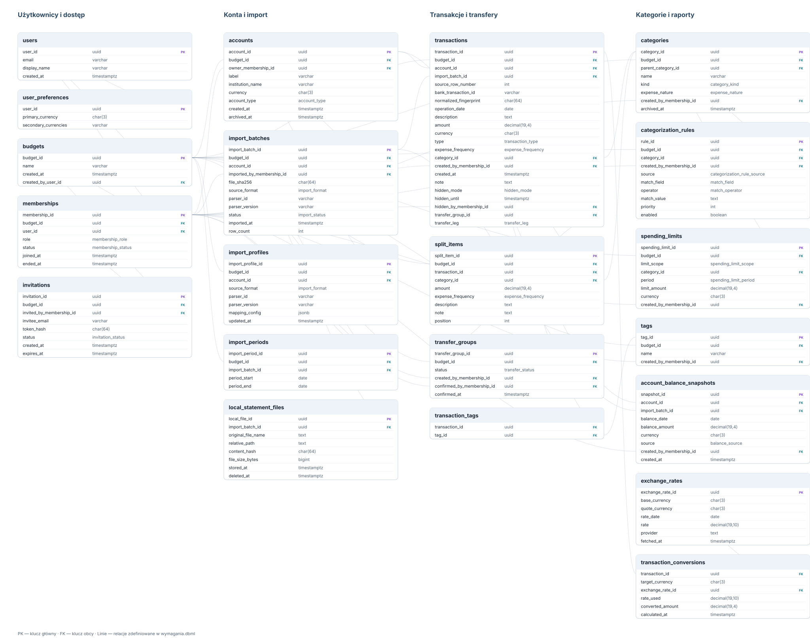

# Wymagania aplikacji do śledzenia wydatków

## 1. Cel i zakres

Aplikacja ma ułatwiać osobom prywatnym analizowanie wydatków i planowanie budżetu na podstawie wyciągów bankowych. Ma być instalowaną aplikacją desktopową dla macOS i Windows, z możliwie takim samym wyglądem i zachowaniem na obu systemach.

Pierwsze wdrożenie (MVP) obejmuje import plików z dostarczonych wyciągów: dwóch układów CSV (historia transakcji i konto oszczędnościowe) oraz tekstowego PDF, a także kategoryzowanie transakcji, analizę budżetu i współdzielenie budżetu. Te profile pochodzą z wyciągów Revolut. W następnej wersji planowane jest rozszerzenie importu CSV i PDF o kolejne banki, m.in. ERSTE, ING, Zürcher Kantonalbank (ZKB) i ABN AMRO. Aplikacja nie łączy się bezpośrednio z bankami.

Pierwszy etap obsługuje wyłącznie wymienione profile. Architektura profili powinna pozwalać dodawać kolejne formaty, ale nie wolno deklarować ani sugerować, że formaty kolejnych banków są już obsługiwane przed ich implementacją i przetestowaniem. Skanowane PDF-y i OCR są poza zakresem MVP; ich ewentualne dodanie wymaga osobnej decyzji.

## 2. Użytkownicy i pojęcia

- **Użytkownik** — osoba logująca się do aplikacji kontem Google.
- **Budżet** — przestrzeń zawierająca transakcje, kategorie i ustawienia; może należeć do jednej osoby lub być współdzielona.
- **Członek budżetu** — użytkownik zaproszony do budżetu.
- **Właściciel konta źródłowego** — członek budżetu, do którego przypisane są transakcje i saldo konta.
- **Importujący** — zalogowany użytkownik wykonujący import; może być inną osobą niż właściciel konta źródłowego wyłącznie przy imporcie PDF „w imieniu” członka budżetu.
- **Transakcja** — operacja zaimportowana z wyciągu albo dodana ręcznie.
- **Wydatek/przychód** — transakcja zaklasyfikowana jako wydatek lub przychód.
- **Przelew wewnętrzny** — przesunięcie pieniędzy, które nie powinno być liczone jako przychód ani wydatek budżetu.

## 3. Wymagania funkcjonalne

### 3.1. Konto i dostęp

- **FR-01** Użytkownik może zalogować się i wylogować za pomocą konta Google.
- **FR-02** Użytkownik może utworzyć własny budżet.
- **FR-03** Administrator budżetu może utworzyć link zaproszeniowy do budżetu, który może udostępnić poza aplikacją, np. przez WhatsApp.
- **FR-04** Osoba otwierająca aktywny link zaproszeniowy może po zalogowaniu kontem Google zaakceptować zaproszenie i dołączyć do budżetu albo je odrzucić. Link jest ważny przez 7 dni od utworzenia, może zostać wcześniej anulowany przez administratora i nie może zostać użyty ponownie po zaakceptowaniu, odrzuceniu, anulowaniu lub wygaśnięciu.
- **FR-05** Aplikacja ogranicza dostęp do danych do użytkowników będących członkami danego budżetu.
- **FR-06** Administrator budżetu może usuwać członków ze wspólnego budżetu.
- **FR-07** Jeśli administrator opuszcza budżet, aplikacja automatycznie przekazuje rolę administratora pierwszemu pozostałemu członkowi na liście uporządkowanej według daty dołączenia; przy tej samej dacie rozstrzyga identyfikator członkostwa.
- **FR-08** Transakcje dodane przez osobę, która opuściła lub została usunięta z budżetu, pozostają w budżecie. Jej ukryte transakcje nadal pozostają ukryte przed pozostałymi członkami.
- **FR-09** Budżetu nie można usunąć, gdy ma aktywnych członków.

### 3.2. Import transakcji z CSV

- **FR-10** Użytkownik może wybrać lokalny plik CSV w obsługiwanym profilu i zaimportować zawarte w nim transakcje. Import CSV przypisuje konto i transakcje do zalogowanego użytkownika Google; nie wymaga ani nie umożliwia wskazania innego właściciela.
- **FR-11** Import nie wysyła oryginalnego pliku wyciągu do usługi zewnętrznej. Do synchronizacji trafiają wyłącznie dane transakcji zatwierdzone do importu.
- **FR-12** Przed zapisaniem aplikacja pokazuje podgląd wszystkich wierszy, rozpoznane pola oraz błędy. Użytkownik może sprawdzić lub poprawić separator, kodowanie, format daty, zapis kwoty i waluty oraz mapowanie kolumn, m.in. daty, opisu, kwoty, opłaty i waluty.
- **FR-13** Parser CSV rozpoznaje separator i kodowanie pliku (z uwzględnieniem BOM), format daty, zapis kwot oraz walutę; użytkownik może poprawić te ustawienia w podglądzie. Wiersze błędne lub nierozpoznane pozostają widoczne w podglądzie i wymagają poprawy albo jawnej decyzji użytkownika o ich wyłączeniu; aplikacja nie pomija ich po cichu.
- **FR-14** Aplikacja rozpoznaje ponownie importowany plik dla tego samego konta i nie importuje ponownie tych samych transakcji. Gdy format wyciągu nie zawiera unikalnego identyfikatora transakcji, aplikacja pokazuje możliwe duplikaty do potwierdzenia zamiast usuwać je automatycznie.
- **FR-15** Użytkownik może anulować import przed zatwierdzeniem.
- **FR-16** Aplikacja zawiera dwa wbudowane profile CSV z pierwszego etapu i automatycznie rozpoznaje ich układ. Pierwszy profil mapuje historię transakcji z kolumnami `Rodzaj`, `Produkt`, `Data rozpoczęcia`, `Data zrealizowania`, `Opis`, `Kwota`, `Opłata`, `Waluta`, `State` i `Saldo`; obsługuje datę `YYYY-MM-DD HH:mm:ss`, kwoty dziesiętne z kropką oraz walutę z osobnej kolumny. Za datę operacji przyjmuje `Data zrealizowania`, jeśli jest dostępna, w przeciwnym razie `Data rozpoczęcia`; brak daty realizacji i status operacji zachowuje jako informację o operacji oczekującej. `Kwota` i `Opłata` są odrębnymi polami: opłaty nie wolno dodawać do kwoty transakcji ani pomijać. `Saldo` nie jest kwotą transakcji; jeśli jest zapisywane, stanowi saldo konta z datą operacji. Drugi profil mapuje wyciąg konta oszczędnościowego z kolumnami `Data`, `Opis`, `Wypłata pieniędzy`, `Wpływy` i `Saldo`; obsługuje polską datę `D MMM YYYY`, kwoty z przecinkiem dziesiętnym, spacją lub twardą spacją jako separatorem tysięcy oraz kod waluty dołączony do kwoty. Wiersz zawiera kwotę wypłaty albo wpływu; wypełnienie obu pól jest błędem do poprawy. Kwota jest transakcją, a `Saldo` jest zapisywane jako saldo konta z datą i walutą wiersza, nigdy jako dodatkowa transakcja.
- **FR-17** W pierwszym etapie użytkownik może zaimportować lokalny, tekstowy PDF w obsługiwanym profilu. Obsługę formatów PDF kolejnych banków planuje się w następnej wersji; nie należy jej deklarować przed dodaniem i przetestowaniem odpowiednich profili. Nieznane układy PDF oraz skanowane PDF-y nie są obsługiwane w MVP; aplikacja jasno informuje o ograniczeniu i nie przedstawia nieudanego parsowania jako pustego, poprawnego importu.
- **FR-18** Aplikacja lokalnie wyodrębnia transakcje z obsługiwanego PDF i pokazuje wynik do weryfikacji przed zapisaniem. Przy imporcie PDF do wspólnego budżetu importujący może wskazać aktywnego członka, w którego imieniu importuje; aplikacja zachowuje oddzielnie tożsamość zalogowanego importującego i właściciela konta.
- **FR-19** Import PDF nie może po cichu zapisywać niepewnie rozpoznanych kwot, dat ani opisów. Błędne lub niejednoznaczne wiersze wymagają poprawy albo jawnej decyzji o ich wyłączeniu; nie są pomijane bez informacji.

### 3.3. Transakcje i kategorie

- **FR-20** Aplikacja rozpoznaje podstawowe informacje transakcji: datę, opis, kwotę oraz walutę. Zachowuje kwotę i walutę źródłową transakcji.
- **FR-21** Użytkownik może ustawić walutę główną, w której prezentowane są podsumowania i raporty, oraz waluty pomocnicze, w których może wyświetlać dodatkowe przeliczone wartości.
- **FR-22** Domyślną walutą główną jest CHF, a domyślnymi walutami pomocniczymi są PLN i EUR. Użytkownik może zmienić walutę główną i wybrane waluty pomocnicze w ustawieniach aplikacji.
- **FR-23** Przy wyświetlaniu kwoty w walucie innej niż źródłowa aplikacja używa kursu z dnia transakcji albo, jeśli jest niedostępny, z najbliższego wcześniejszego dnia, dla którego kurs jest dostępny. Zapisuje zastosowany kurs, jego datę i przeliczoną kwotę dla wybranych walut prezentacji oraz pokazuje walutę źródłową. Obliczenia wykonuje na wartościach dziesiętnych; kwoty prezentowane zaokrągla do najmniejszej jednostki danej waluty metodą „połówki w górę” (HALF_UP), a podsumowania wylicza przed zaokrągleniem prezentowanej sumy. Nie zastępuje ani nie zmienia oryginalnej kwoty transakcji.
- **FR-24** Transakcje są klasyfikowane co najmniej jako wydatek, przychód lub przelew wewnętrzny.
- **FR-25** Aplikacja automatycznie stosuje pasującą regułę kategoryzacji. Na podstawie wcześniejszych korekt może też podpowiadać kategorię, ale nową podpowiedź stosuje dopiero po potwierdzeniu użytkownika. Użytkownik może zawsze zmienić kategorię.
- **FR-26** Użytkownik może tworzyć, zmieniać nazwę i porządkować kategorie, np. jedzenie, transport, mieszkanie, zdrowie i elektronika.
- **FR-27** Użytkownik może oznaczyć transakcję etykietą lub dodać notatkę.
- **FR-28** Użytkownik może wyszukiwać, filtrować i sortować transakcje, m.in. po dacie, kwocie, kategorii, opisie i typie.
- **FR-29** Aplikacja zachowuje powiązanie transakcji z kontem źródłowym, jego właścicielem, importem oraz zalogowanym importującym, a także — jeśli jest dostępny — identyfikator transakcji nadany przez bank.

### 3.4. Dzielenie transakcji

- **FR-30** Użytkownik może podzielić kwotę jednej transakcji na co najmniej dwie pozycje składowe. Każda pozycja może mieć własną kwotę, kategorię i opis.
- **FR-31** Każda pozycja podziału może mieć własną kwotę, kategorię i opcjonalny opis lub notatkę.
- **FR-32** Suma kwot pozycji podziału musi być równa kwocie transakcji źródłowej; aplikacja pokazuje pozostałą do podziału kwotę i nie pozwala zatwierdzić niezgodnego podziału.
- **FR-33** Użytkownik może edytować lub usunąć podział i przywrócić transakcję do pojedynczej pozycji.
- **FR-34** W zestawieniach aplikacja uwzględnia pozycje podziału zamiast ponownie doliczać pełną kwotę transakcji źródłowej.

### 3.5. Reguły kategoryzacji

- **FR-35** Użytkownik może dodać regułę przypisującą kategorię na podstawie rozpoznanego fragmentu opisu lub innego wybranego kryterium.
- **FR-36** Użytkownik może zdecydować, czy zmiana kategorii ma dotyczyć tylko tej transakcji, czy również tworzyć regułę dla przyszłych transakcji. Aplikacja zapamiętuje korekty i na ich podstawie może proponować kategorię dla podobnych transakcji; użytkownik potwierdza każdą taką propozycję przed jej zastosowaniem.
- **FR-37** Reguły nie mogą nadpisywać ręcznie ustawionej kategorii bez wyraźnej zgody użytkownika.

### 3.6. Rozpoznawanie przelewów

- **FR-38** Użytkownik może dodać wiele kont źródłowych do budżetu, podając dla każdego nazwę lub etykietę, bank, walutę i właściciela będącego aktywnym członkiem budżetu; dane logowania do banku nie są wymagane. W CSV właścicielem jest zawsze zalogowane konto Google. Przy PDF importujący może wybrać aktywnego członka jako właściciela, ale zapis nie może podszywać się pod tę osobę: tożsamość importującego pozostaje zapisana oddzielnie.
- **FR-39** Aplikacja pomaga wykryć transfer między kontami należącymi do tego samego lub różnych członków wspólnego budżetu jako parę powiązanych transakcji wychodzącej i przychodzącej, na podstawie m.in. kwoty, daty, opisu oraz kont źródłowych.
- **FR-40** Użytkownik może potwierdzić, skorygować lub odrzucić sugestię rozpoznania przelewu. Jeśli wykryto tylko jedną stronę transferu, aplikacja ostrzega o braku drugiej transakcji i wymaga potwierdzenia przed uznaniem jej za transfer.
- **FR-41** Potwierdzony przelew wewnętrzny jest pomijany w sumach przychodów i wydatków, aby nie zawyżał raportów.
- **FR-42** Potwierdzony transfer między kontami różnych członków tego samego budżetu jest transferem wewnętrznym, a nie wydatkiem jednej osoby i przychodem drugiej. Przy transferze między walutami opłaty bankowe i różnice kwot wynikające z wymiany są wykazywane jako wydatki i nie mogą znikać z raportów.

### 3.7. Budżety, raporty i oszczędności

- **FR-43** Użytkownik może przeglądać sumy przychodów, wydatków i przepływów za wybrany okres.
- **FR-44** Użytkownik może przeglądać wydatki według kategorii i porównywać okresy.
- **FR-45** Użytkownik może ustawić miesięczny limit dla kategorii, wszystkich wydatków oraz wydatków jednorazowych i otrzymać informację o wykorzystaniu każdego limitu.
- **FR-46** Użytkownik może oznaczyć kategorie wydatków jako stałe, zmienne lub uznaniowe, aby wykorzystać je przy szacowaniu oszczędności. Może też oznaczyć wydatek (lub pozycję jego podziału) jako cykliczny, nieregularny albo jednorazowy. Wydatki nieregularne i jednorazowe pozostają wydatkami, ale nie są wliczane do miesięcznych kosztów cyklicznych. Wydatki bez określonej częstotliwości są wyraźnie oznaczone i również nie są zaliczane do kosztów cyklicznych.
- **FR-47** Aplikacja wylicza kwotę pozostałą w wybranym okresie jako dochody minus wszystkie wydatki, w tym nieregularne i jednorazowe. Użytkownik może wybrać horyzont historyczny używany do wyliczenia średniej kwoty pozostałej i szacunku przyszłych oszczędności. Szacunek jest prezentowany w przeliczeniu na miesiąc, opisuje potencjalnie pozostałe środki, a nie kwotę już odłożoną; wydatki jednorazowe i nieregularne są uwzględniane w wydatkach okresu, ale nie w miesięcznych kosztach cyklicznych.
- **FR-48** Aplikacja pokazuje okres i założenia szacunku oszczędności oraz odróżnia pozostałe środki od oficjalnych oszczędności. Oficjalne oszczędności są prezentowane na podstawie zapisanych sald kont oszczędnościowych; aplikacja pokazuje saldo i datę dla każdego konta osobno.
- **FR-49** Raporty nie wliczają potwierdzonych przelewów wewnętrznych do wydatków ani przychodów.

### 3.8. Ukrywanie transakcji

- **FR-50** Użytkownik może ukryć opis transakcji albo całą transakcję na 1 dzień, 1 tydzień, 1 miesiąc, na własny okres lub bezterminowo, np. w celu zachowania niespodzianki.
- **FR-51** Po upływie wybranego okresu ukrycie wygasa automatycznie, a transakcja staje się widoczna wszystkim członkom budżetu. Ukrycie bezterminowe nie wygasa automatycznie.
- **FR-52** Ukryta transakcja nie pokazuje swoich szczegółów pozostałym członkom budżetu, ale pozostaje widoczna dla osoby, która ją ukryła, dopóki ma dostęp do budżetu. Pozostali członkowie są informowani, czy transakcja stanie się widoczna po określonym czasie, czy pozostanie ukryta bezterminowo.
- **FR-53** Ukrycie szczegółów nie może po cichu zniekształcać sum budżetu. Transakcje ukryte w całości nadal są uwzględniane w sumach i wykresach, ale ich opis nie jest widoczny pozostałym członkom.
- **FR-54** Usunięcie autora ukrytej transakcji z budżetu nie powoduje jej ujawnienia. Ukryta transakcja pozostaje ukryta dla pozostałych członków i nie może zostać ręcznie ujawniona.

### 3.9. Eksport danych

- **FR-55** Aplikacja udostępnia osobne rodzaje eksportu: dane transakcji do CSV lub XLSX, konfigurację aplikacji do JSON oraz raport podsumowujący do PDF.
- **FR-56** Eksport danych do CSV lub XLSX może obejmować cały budżet, transakcje z wybranego zakresu dat albo wyniki aktualnie zastosowanych filtrów.
- **FR-57** Eksport CSV i XLSX zawiera dane transakcji w formie nadającej się do dalszej analizy, w tym datę, opis, typ, kwotę, walutę źródłową i kategorię, o ile dane te są dostępne i widoczne dla eksportującego.
- **FR-58** Jeśli transakcja została podzielona, eksport CSV i XLSX przedstawia jej pozycje składowe wraz z kwotami, kategoriami i opisami. Eksport nie może powodować podwójnego zliczenia kwoty transakcji źródłowej i jej pozycji.
- **FR-59** Eksport konfiguracji do JSON obejmuje ustawienia aplikacji, takie jak waluty, kategorie i reguły kategoryzacji, a nie dane transakcji ani dane logowania.
- **FR-60** Eksport raportu do PDF tworzy podsumowanie widoku obejmujące przychody, wydatki i wykresy dla wybranego zakresu pełnych miesięcy.
- **FR-61** Każdy eksport respektuje uprawnienia eksportującego. Transakcje, których szczegóły są przed nim ukryte, są oznaczone w eksporcie jako ukryte i nie ujawniają informacji objętych ograniczeniem widoczności.
- **FR-62** Przed rozpoczęciem eksportu raportu PDF użytkownik może wybrać miesiąc początkowy i końcowy; raport jasno wskazuje wybrany zakres oraz walutę prezentowanych podsumowań.
- **FR-63** Aplikacja zapisuje wygenerowany plik eksportu lokalnie, w miejscu wybranym przez użytkownika, i informuje go o błędzie, jeśli pliku nie udało się utworzyć.

### 3.10. Przechowywanie zaimportowanych wyciągów

- **FR-64** Po pomyślnym imporcie aplikacja zachowuje oryginalny plik CSV lub PDF w swoim lokalnym katalogu danych, aby użytkownik mógł wrócić do wyciągu bez ponownego pobierania go z banku.
- **FR-65** Użytkownik może otworzyć zachowany oryginalny plik wyciągu z poziomu aplikacji.
- **FR-66** Aplikacja udostępnia zakładkę „Wyciągi” z listą wyciągów pogrupowaną według banku i konta. Pokazuje ona zakres dat objęty każdym zaimportowanym wyciągiem, np. od 28.02.2026 do 24.05.2026. Jeśli wyciągi obejmują nieciągłe zakresy, aplikacja pokazuje je oddzielnie, tak aby nie sugerować pokrycia luk.
- **FR-67** Oryginalne pliki wyciągów pozostają lokalne dla urządzenia, na którym zostały zaimportowane; do innych członków i urządzeń synchronizowane są dane transakcji, nie pliki źródłowe.
- **FR-92** Użytkownik może z poziomu aplikacji ręcznie usunąć zachowany oryginalny plik wyciągu z lokalnego katalogu danych. Usunięcie pliku nie usuwa zaimportowanych transakcji ani wpisu importu i zakresu dat; aplikacja informuje o tym przed usunięciem. Pliki nie są dodatkowo szyfrowane przez aplikację — ochronę na dysku zapewniają mechanizmy systemu operacyjnego.

## 4. Model danych i widoczność

Rozdział opisuje **co aplikacja ma zapisywać i jakie reguły musi zachować**. Pełny schemat tabel, pól, typów, kluczy i relacji znajduje się w [wymagania.dbml](./wymagania.dbml) — ten plik jest źródłem prawdy dla struktury danych. Diagram poniżej ułatwia orientację, ale nie zastępuje DBML ani reguł opisanych w tej sekcji.

Diagram SVG jest podglądem schematu. Po zmianie tabel lub relacji w DBML zaktualizuj również diagram; w razie rozbieżności obowiązuje DBML.

### 4.1. Jak wdrażać model

1. Utwórz tabele, pola, typy, klucze i indeksy zgodnie z `wymagania.dbml`. Nie twórz drugiej, rozbieżnej definicji schematu.
2. Wybierz sposób zapisu odpowiedni dla wybranej bazy. Jeśli używasz Firestore, odwzoruj relacje i unikalność z DBML na dokumenty, indeksy oraz zaufaną logikę serwerową. Nie zakładaj, że interfejs klienta może egzekwować uprawnienia.
3. Każdy rekord należący do budżetu musi być odczytywany i zapisywany w kontekście tego budżetu. Sprawdź, że powiązane konto, kategoria, import, członkostwo i transfer należą do tego samego budżetu.
4. Waliduj zmiany zależne od wielu rekordów atomowo. Zapisz całą operację albo żadną jej część; po błędzie nie zwracaj sukcesu.
5. Dla każdej reguły z listy poniżej dodaj test pozytywny oraz test odrzucenia nieprawidłowego przypadku.

### 4.2. Reguły danych

- **Budżet i dostęp:** dane finansowe są współdzielone wyłącznie przez aktywnych członków budżetu. Każdy budżet ma dokładnie jednego aktywnego administratora. Jeden użytkownik może mieć najwyżej jedno aktywne członkostwo w danym budżecie. Uprawnienia sprawdza backend przy każdym odczycie i zapisie.
- **Członkostwo i usuwanie:** odejście lub usunięcie członka nie usuwa jego transakcji ani historii członkostwa. Usunięcie profilu anonimizuje `user_id` w historycznych członkostwach. Gdy administrator odchodzi, rolę otrzymuje najwcześniej dołączony pozostały członek; remis rozstrzyga `membership_id`. Usunięcie profilu ostatniego aktywnego członka usuwa budżet i jego dane aplikacji.
- **Zaproszenia:** zaproszenie przechowuje skrót nieprzewidywalnego tokenu, a nie token w postaci jawnej. Można go użyć tylko raz, przed upływem 7 dni i przed anulowaniem. Akceptacja wymaga zalogowanego użytkownika.
- **Kwoty i waluty:** kwoty przechowuj jako wartości dziesiętne, nie zmiennoprzecinkowe. Kwota źródłowa transakcji pozostaje niezmieniona. Data operacji jest typu `DATE`, pozostałe znaczniki czasu są w UTC, a waluty są kodami ISO 4217.
- **Importy i pliki:** identyczny plik dla tego samego konta rozpoznaje jego hash. Fingerprint transakcji bez identyfikatora bankowego służy tylko do ostrzeżenia o możliwym duplikacie. Każdy rekord `import_periods` oznacza jeden ciągły zakres; luk nie łącz w jeden przedział. Zapis importu rozróżnia zalogowanego importującego i właściciela konta: dla CSV obie role przypadają zalogowanemu użytkownikowi Google, a dla PDF właścicielem może być wskazany aktywny członek budżetu. Oryginał i jego ścieżka pozostają lokalne. Ręczne usunięcie pliku nie usuwa importu, transakcji ani zakresów dat.
- **Kategorie i podziały:** kategoria przypisana do rekordu musi należeć do tego samego budżetu. Kategorie użyte w historii są archiwizowane zamiast kasowane. Suma kwot pozycji podziału musi być dokładnie równa kwocie transakcji; w raportach i eksporcie licz pozycje podziału zamiast ponownie doliczać transakcję źródłową.
- **Reguły kategorii:** reguły utworzone przez użytkownika mogą kategoryzować automatycznie. Reguły wyuczone są tylko podpowiedziami i wymagają potwierdzenia. Reguła nie nadpisuje kategorii ustawionej ręcznie.
- **Transfery:** sugestia transferu nie zmienia raportów, dopóki użytkownik jej nie potwierdzi. Potwierdzona para zawiera dokładnie jedną transakcję wychodzącą i jedną przychodzącą z tego samego budżetu. Transfer jednostronny wymaga osobnego potwierdzenia po ostrzeżeniu. Potwierdzone transfery nie są przychodem ani wydatkiem; opłaty i różnice walutowe pozostają osobnymi wydatkami.
- **Przeliczenia i salda:** zapisuj użyty kurs, jego datę i wynik przeliczenia; nie nadpisuj kwoty źródłowej. Oficjalne oszczędności obliczaj z najnowszego zapisanego salda każdego konta oszczędnościowego.

### 4.3. Widoczność i retencja

- Wszyscy aktywni członkowie mają dostęp do danych budżetu, z wyjątkiem szczegółów ukrytych przed nimi zgodnie z regułami poniżej.
- Ukrywanie jest regułą prezentacji, a nie zabezpieczeniem danych: pełne dane pozostają zapisane. Tryb `DESCRIPTION` ukrywa opis, a `TRANSACTION` ukrywa wiersz; oba tryby nadal uwzględniają kwotę w podsumowaniach.
- Ukrycie wygasa po `hidden_until`. Brak tej daty przy ustawionym trybie oznacza ukrycie bezterminowe. Usunięcie autora z budżetu nie ujawnia transakcji; ukrytej transakcji nie można ręcznie ujawnić.
- Ukrywający widzi szczegóły, dopóki jest aktywnym członkiem. Pozostali członkowie widzą szczegóły dopiero po wygaśnięciu ukrycia.
- Ustawienia walut są osobiste. Członkowie widzą nazwy wyświetlane, adresy e-mail i role pozostałych członków; ograniczone adresem zaproszenie widzą administrator i zaproszona osoba.
- Pełne zasady logowania, prywatności, kopii zapasowych i usuwania danych określają również wymagania TR-05–TR-10 oraz FR-68–FR-91. Lokalne kopie zapasowe pozostają poza kontrolą aplikacji.

## 5. Wymagania techniczne i jakościowe

### 5.1. Platforma i zachowanie aplikacji

- **TR-01** Aplikacja jest instalowana na macOS i Windows; Linux nie jest wymagany.
- **TR-02** Interfejs powinien działać i wyglądać spójnie na obu systemach, z uwzględnieniem różnic systemowych, takich jak okna dialogowe wyboru plików.
- **TR-03** Aplikacja zapewnia logowanie kontem Google i synchronizację danych budżetu pomiędzy uprawnionymi użytkownikami oraz ich urządzeniami. Umożliwia przeglądanie wcześniej pobranych danych oraz kolejkowanie zmian bez połączenia i synchronizuje je po jego odzyskaniu. Aplikacja jasno odróżnia dane lokalnie zapisane lub oczekujące na synchronizację od potwierdzonych zmian zdalnych. Rozstrzyganie równoczesnych zmian nie może po cichu prowadzić do utraty danych; operacje wymagające dostępu do serwera są wstrzymywane do czasu połączenia, a interfejs nie zgłasza ich powodzenia przed potwierdzeniem.
- **TR-04** Aplikacja jest instalowaną aplikacją desktopową i nie wymaga dostępu przez przeglądarkę.

### 5.2. Bezpieczeństwo i prywatność

- **TR-05** Dane są przesyłane przez szyfrowane połączenie sieciowe.
- **TR-06** Usługa przechowująca dane egzekwuje uprawnienia dostępu do budżetu po stronie serwera; sama kontrola interfejsu aplikacji nie jest zabezpieczeniem.
- **TR-07** Klucze i sekrety administracyjne usług zaplecza nie mogą być umieszczane w aplikacji klienckiej.
- **TR-08** Importowanie i parsowanie obsługiwanych plików CSV i PDF oraz uczenie podpowiedzi kategorii na podstawie korekt odbywa się lokalnie. Wyuczone podpowiedzi są synchronizowane jako reguły budżetu; opisy transakcji nie są wysyłane do zewnętrznych usług w celu kategoryzacji. Oryginalne pliki są przechowywane w lokalnym katalogu danych aplikacji; pliki ani ich zawartość nie są wysyłane do zewnętrznych usług ani synchronizowane między urządzeniami.
- **TR-09** Dane budżetu i członkostwa są przechowywane do czasu usunięcia budżetu lub konta; zakres pól oraz widoczność danych dla członków określa rozdział „Model danych i widoczność”.
- **TR-10** Dane są chronione szyfrowaniem połączenia sieciowego oraz standardowym szyfrowaniem zapewnianym przez usługę chmurową; szyfrowanie end-to-end nie jest wymagane. Ukrycie transakcji jest funkcją prezentacji i uprawnień, a nie obietnicą tajemnicy przed osobą mającą dostęp do bazy lub kopii danych.
- **TR-11** Błędy importu, synchronizacji i logowania są komunikowane użytkownikowi wprost; aplikacja nie może sugerować, że dane zapisano, jeśli zapis się nie powiódł.

### 5.3. Niezawodność, testowanie i dystrybucja

- **TR-12** Operacje importu i synchronizacji powinny być odporne na ponowienie oraz nie tworzyć dodatkowych transakcji przy powtórzeniu tej samej operacji.
- **TR-13** Należy testować wszystkie profile CSV i PDF objęte bieżącym etapem na zanonimizowanych fixture'ach. Testy CSV obejmują separator, kodowanie, nagłówki, format daty, separator dziesiętny i tysięcy, walutę, opłatę, saldo, status oczekujący, pusty plik oraz błędne i nierozpoznane wiersze. Błąd nie może prowadzić do cichego pominięcia wiersza.
- **TR-14** Należy testować reguły dostępu do danych, zaproszenia i zachowanie wspólnych budżetów.
- **TR-15** Wydania powinny być budowane i sprawdzane osobno dla macOS i Windows.
- **TR-16** Aplikacja jest przeznaczona do użytku prywatnego i nie będzie publikowana w sklepach z aplikacjami. Należy przygotować możliwość instalacji na macOS i Windows oraz ustalić potrzebny sposób podpisywania i aktualizacji.
- **TR-17** Projekt powinien mieć automatyczne testy logiki biznesowej i parserów oraz minimalny zestaw testów interfejsu dla kluczowych przepływów.
- **TR-18** Model danych i logika raportowania muszą zachowywać kwotę transakcji źródłowej oraz pozycje jej podziału bez podwójnego liczenia; walidacja sumy podziału musi być testowana.
- **TR-19** Testy kopii zapasowych obejmują utworzenie i odtworzenie lokalnej kopii, odrzucenie kopii uszkodzonej lub niezgodnej, zachowanie bieżących danych po błędzie odtwarzania oraz weryfikację uprawnień po przywróceniu.

### 5.4. Koszt i utrzymanie

- **TR-20** Preferowane są bezpłatne plany usług. Projekt powinien mierzyć rzeczywiste zużycie i nie zakładać, że bezpłatne limity są bezwarunkowe, stałe lub wystarczą przy każdym poziomie użycia.
- **TR-21** Przed wdrożeniem należy wybrać plan usług, określić wymagania rozliczeniowe, monitorować zużycie i skonfigurować alerty kosztowe. Alerty budżetowe informują o prognozowanych wydatkach, ale same nie są twardym limitem ani gwarancją zatrzymania naliczania opłat.
- **TR-22** Powinna istnieć możliwość eksportu danych, aby użytkownik nie był uzależniony wyłącznie od jednej usługi lub formatu.

#### Orientacyjna analiza kosztów zaplecza

Stan cennika sprawdzono 25.10.2026. Kwoty i limity mogą się zmieniać; przed wdrożeniem należy ponownie sprawdzić cennik dla wybranego regionu.

| Usługa | Bezpłatne użycie i możliwe opłaty | Ocena dla aplikacji |
|---|---|---|
| Firebase Authentication | Standardowe logowanie Google należy do bezpłatnych metod uwierzytelniania. Logowanie SMS i dodatkowe funkcje Identity Platform mogą mieć osobny cennik. | Samo logowanie Google nie powinno generować opłat. |
| Cloud Firestore Standard | Dla jednej kwalifikującej się bazy danych w projekcie: 1 GiB danych, 50 000 odczytów dokumentów dziennie, 20 000 zapisów dziennie, 20 000 usunięć dziennie i 10 GiB transferu wychodzącego miesięcznie. Po przekroczeniu limitów na planie Blaze naliczane są opłaty zależne od regionu i rodzaju operacji. | Dla prywatnej aplikacji z małą liczbą członków budżetów prawdopodobne jest zmieszczenie się w bezpłatnym limicie. Sam limit nie gwarantuje kosztu zerowego — nadmiernie częste odświeżanie, szerokie nasłuchy i pobieranie całej historii mogą zwiększać odczyty i transfer. |
| Cloud Functions | Dostęp do wdrażania funkcji wymaga planu Blaze i podpiętego konta rozliczeniowego, nawet jeśli wykorzystanie pozostaje w bezpłatnym limicie. Cennik Firebase wskazuje m.in. do 2 mln wywołań funkcji miesięcznie bez opłaty; czas procesora, pamięć, sieć i usługi powiązane również podlegają limitom/cennikom. | Jeśli zaufana obsługa zaproszeń lub zmian członkostwa będzie wymagała funkcji serwerowych, trzeba zaakceptować Blaze i monitorować całość rozliczeń projektu. |
| Kopie i odzyskiwanie Firestore | Automatyczne backupy, odtwarzanie, klonowanie i point-in-time recovery nie korzystają ze standardowego bezpłatnego limitu Firestore. | Obecny wymóg lokalnych kopii zapasowych pozwala nie włączać tych płatnych funkcji chmurowych. |
| Przechowywanie plików | Oryginalne wyciągi oraz kopie zapasowe są lokalne, nie w Firebase Storage. | Brak opłat za ich przechowywanie w chmurze; koszt zajętego miejsca ponosi lokalnie użytkownik. |
| Kursy walut | Wybrane Frankfurter API deklaruje bezpłatny dostęp bez klucza. Dostępność i warunki usługi zewnętrznej mogą się zmienić. | Żądania zawierają kody walut i daty, nie opisy ani kwoty transakcji; buforowanie ograniczy liczbę zapytań. |

**Wniosek:** Firestore jest dostępny bez opłat w ramach limitów bezpłatnego użycia; nie jest jednak bezwarunkowo ani bezlimitowo darmowy. Plan Spark nie wymaga podpięcia karty, ale nie umożliwia rozliczania nadmiarowego wykorzystania — przekroczenie limitu może ograniczyć działanie usługi. Plan Blaze nie ma stałej opłaty za sam plan, lecz wymaga konta rozliczeniowego i nalicza opłaty za wykorzystanie ponad bezpłatne limity. Warto też uwzględnić możliwe, niezależne od Firebase koszty podpisywania i dystrybucji prywatnych instalatorów.

Źródła: [cennik Firebase](https://firebase.google.com/pricing), [szczegóły cen Firestore](https://firebase.google.com/docs/firestore/pricing), [plany rozliczeniowe Firebase](https://firebase.google.com/docs/projects/billing/firebase-pricing-plans).

## 6. Kopie zapasowe i odzyskiwanie danych

### 6.1. Wymagania funkcjonalne

#### 6.1.1 Tworzenie kopii

- **FR-68** Użytkownik może ręcznie utworzyć pełną kopię zapasową budżetu jako plik zapisany lokalnie w wybranym przez siebie miejscu.
- **FR-69** Przed zapisaniem lokalnej kopii aplikacja informuje, że plik nie jest szyfrowany i zawiera wrażliwe dane finansowe.
- **FR-70** Kopia zapasowa obejmuje transakcje, ich podziały, powiązania transferów oraz zachowane oryginalne pliki wyciągów dostępne na urządzeniu tworzącym kopię. Pliki wyciągów znajdują się wyłącznie w lokalnym pliku kopii; przy odtwarzaniu trafiają do lokalnego katalogu danych urządzenia, na którym odtwarzanie wykonano, i nadal nie są synchronizowane z innymi urządzeniami ani członkami budżetu (FR-67).
- **FR-71** Kopia zapasowa obejmuje kategorie, klasyfikację wydatków, reguły, konta, salda, ustawienia importu, notatki, etykiety, limity, ustawienia walut i przeliczenia.
- **FR-72** Kopia zapasowa obejmuje dane członkostwa potrzebne do odtworzenia budżetu z zachowaniem weryfikacji tożsamości i uprawnień.
- **FR-73** Kopia zapasowa nie obejmuje haseł, tokenów logowania ani sekretów uwierzytelniających.

#### 6.1.2 Odzyskiwanie danych

- **FR-74** Aplikacja udostępnia sekcję „Kopie zapasowe i odzyskiwanie” z instrukcją tworzenia i przywracania lokalnych kopii.
- **FR-75** Użytkownik może wskazać lokalny plik kopii zapasowej i rozpocząć odzyskiwanie danych.
- **FR-76** Przed odtworzeniem aplikacja pokazuje datę, budżet i zakres danych zawartych w kopii.
- **FR-77** Przed odtworzeniem aplikacja sprawdza integralność kopii i jej zgodność z obsługiwaną wersją danych.
- **FR-78** Aplikacja odrzuca uszkodzoną lub niezgodną kopię bez częściowego nadpisania bieżących danych.
- **FR-79** Użytkownik wybiera budżet docelowy spośród istniejących budżetów, do których ma uprawnienia; przywrócenie nie tworzy nowego budżetu.
- **FR-80** Przed przywróceniem użytkownik wybiera jeden z dwóch trybów: zastąpienie danych budżetu stanem z kopii albo scalenie danych z kopii z danymi budżetu.
- **FR-81** Zastąpienie danych wymaga wyraźnego potwierdzenia użytkownika i zastępuje dane wskazanego budżetu stanem z wybranej kopii.
- **FR-82** Przy scalaniu aplikacja zachowuje istniejące dane budżetu, dodaje dane z kopii i nie zastępuje całości bieżącego stanu.
- **FR-83** Jeśli podczas scalania aplikacja wykryje konflikt między rekordem z kopii a rekordem istniejącym, pokazuje użytkownikowi każdy konflikt osobno i pozwala wybrać sposób jego rozstrzygnięcia.
- **FR-84** Przed zastąpieniem lub scaleniem aplikacja tworzy lokalną kopię aktualnego stanu budżetu, aby umożliwić powrót po pomyłce.
- **FR-85** Podczas odtwarzania aplikacja pokazuje postęp oraz informuje o wyniku operacji.
- **FR-86** Jeśli odtwarzanie się nie powiedzie, aplikacja informuje o błędzie i pozostawia bieżące dane nienaruszone.

#### 6.1.3 Usuwanie danych i dostęp po odtworzeniu

- **FR-87** Użytkownik może trwale usunąć swój profil; trwałe usunięcie budżetu podlega zasadzie, że nie można go usunąć, gdy ma aktywnych członków.
- **FR-88** Usunięcie profilu kończy jego aktywne członkostwa; rekordy historycznych członkostw pozostają, identyfikatory usuniętego użytkownika są anonimizowane, a autor jest prezentowany jako „Usunięty użytkownik”.
- **FR-89** Usunięcie profilu ostatniego aktywnego członka powoduje automatyczne usunięcie budżetu i jego danych przechowywanych przez aplikację.
- **FR-90** Przed usunięciem profilu lub budżetu aplikacja informuje, że lokalnie utworzone pliki kopii zapasowych pozostają poza jej kontrolą i należy usunąć je osobno.
- **FR-91** Odtworzenie nie przyznaje dostępu osobom, które nie są uprawnionymi członkami budżetu; tożsamość i uprawnienia członków są weryfikowane.

### 6.2. Wymagania techniczne dotyczące kopii

- **TR-23** Lokalny plik kopii jest zapisywany bez szyfrowania i nie zawiera haseł, tokenów logowania ani sekretów uwierzytelniających.
- **TR-24** Format kopii zawiera wersję schematu danych; aplikacja sprawdza zgodność i jawnie migruje obsługiwane starsze wersje przed odtworzeniem.
- **TR-25** Zastąpienie i scalenie są atomowe: wszystkie walidacje i zapis danych kończą się poprawnie albo bieżący budżet pozostaje nienaruszony.

### 6.3. Przepływ odzyskiwania

1. Użytkownik otwiera w aplikacji sekcję „Kopie zapasowe i odzyskiwanie”.
2. Wybiera opcję utworzenia kopii lokalnej albo wskazuje lokalny plik kopii do odtworzenia.
3. Przed zapisem kopii aplikacja przypomina, że plik nie jest szyfrowany i zawiera dane finansowe.
4. Przed odtworzeniem aplikacja sprawdza plik i pokazuje jego datę, zawartość oraz budżet, którego dotyczy.
5. Użytkownik wybiera istniejący budżet docelowy oraz tryb: zastąpienie albo scalenie.
6. Aplikacja pokazuje podsumowanie operacji; w trybie zastąpienia wymaga potwierdzenia, a w trybie scalania pozwala rozstrzygnąć wykryte konflikty.
7. Aplikacja tworzy lokalną kopię aktualnego stanu, wykonuje wybraną operację i pokazuje wynik.

## 7. Proponowane technologie

Poniższa tabela zawiera wstępne propozycje technologiczne, a nie wymagania wiążące. Należy je zweryfikować w prototypie, szczególnie przepływ logowania desktopowego, koszty usług chmurowych oraz obsługę plików PDF.

| Obszar | Proponowana technologia | Uzasadnienie / uwagi |
|---|---|---|
| Aplikacja desktopowa | Electron | Wspólny runtime oparty na Chromium dla macOS i Windows ułatwia uzyskanie spójnego wyglądu i zachowania. Wiąże się z większym rozmiarem instalatora i zużyciem zasobów. |
| Interfejs użytkownika | React | Popularna biblioteka do budowania interfejsów; może być współdzielona między platformami desktopowymi. |
| Język aplikacji | TypeScript | Statyczne typowanie pomaga utrzymać czytelność i bezpieczeństwo zmian w rozbudowującym się projekcie. |
| Logowanie | Firebase Authentication z Google | Proponowany dostawca logowania Google. Prototyp ma sprawdzić przepływ OAuth w zewnętrznej przeglądarce systemowej (nie w osadzonym oknie webview), zgodnie z zaleceniami Google dla aplikacji natywnych: PKCE, powrót do aplikacji przez przekierowanie na adres loopback lub własny schemat URI oraz wymianę uzyskanego poświadczenia Google na sesję Firebase. Trzeba też sprawdzić obsługę sesji (trwałość, odświeżanie, wylogowanie) i odbiór linków zaproszeniowych w aplikacji. Nie należy zakładać, że standardowy webowy przepływ popup/redirect Firebase zadziała w Electron bez zmian. |
| Baza danych i synchronizacja | Cloud Firestore | Proponowana chmurowa baza do współdzielenia i synchronizacji budżetów; reguły dostępu muszą być egzekwowane po stronie usługi. W aplikacji Electron korzystającej z webowego SDK trzeba jawnie włączyć trwałą pamięć podręczną. Firestore synchronizuje zapisy offline po odzyskaniu połączenia; przy wielu zapisach offline do tego samego dokumentu stosuje zasadę „ostatni zapis wygrywa”, dlatego schemat powinien ograniczać konflikty i nadpisywanie niezależnych zmian. Transakcje Firestore wymagają połączenia z serwerem. Zakres cache i jego czyszczenie po wylogowaniu to otwarty punkt z rozdziału 9. Limity i koszty wymagają sprawdzenia. |
| Import CSV i PDF | Lokalne biblioteki parsujące pliki | Pliki wyciągów są przetwarzane lokalnie. W prototypie należy zweryfikować profile opisane w FR-16 i FR-17 na dostarczonych przykładach. Obsługa kolejnych banków jest planowana na następną wersję; skanowane PDF-y i OCR pozostają poza zakresem MVP. |
| Źródło kursów walut | Frankfurter API v2, z jawnie wybranym dostawcą ECB | Bezpłatne API bez klucza, udostępniające dane historyczne. Domyślnie zwraca kursy łączone z wielu źródeł, dlatego aplikacja musi jawnie wybrać dostawcę ECB (kursy referencyjne Europejskiego Banku Centralnego). Zapytania dotyczą wyłącznie kodów walut i dat, nie danych transakcji. Używać kursu z najbliższego wcześniejszego dnia dostępnego w źródle, zapisywać faktyczną datę kursu i buforować pobrane kursy. Należy obsłużyć brak kursu dla wybranej daty lub waluty. |
| OCR skanowanych PDF-ów | Poza zakresem MVP | Import skanowanych PDF-ów i OCR można rozważyć w późniejszym zakresie; aplikacja informuje o braku obsługi skanu. |
| Wykresy w interfejsie | Biblioteka do wykresów — do wyboru | Wybór dotyczy wyłącznie wyświetlania wykresów w interfejsie; nie musi obsługiwać eksportu do PDF. |
| Eksport raportu PDF | Drukowanie widoku przez Electron albo osobna biblioteka PDF — do wyboru w prototypie | Sposób generowania PDF wybiera się niezależnie od biblioteki wykresów; musi umożliwiać umieszczenie wykresów w raporcie. |
| Budowanie i dystrybucja | Narzędzie dla Electron — do wyboru | Wymaga przygotowania prywatnych instalatorów dla macOS i Windows; aplikacja nie będzie publikowana w sklepach. Prototyp powinien sprawdzić podpisywanie i notaryzację na macOS, podpisywanie na Windows oraz mechanizm aktualizacji (TR-16). |

## 8. Plan implementacji krok po kroku

Plan prowadzi od prototypu do wydania aplikacji. MVP implementuje profile opisane w FR-16 i FR-17; rozszerzenie obsługi o kolejne banki jest zaplanowane na następną wersję. Każdy etap kończy się działającym, sprawdzonym fragmentem aplikacji; nie przechodź dalej, jeśli kryteria ukończenia etapu nie są spełnione.

### Instrukcje dla AI realizującej projekt

1. Przed zmianami sprawdź istniejące pliki, strukturę repozytorium, używane wersje narzędzi, aktualne testy i stan pracy. Zachowaj niezwiązane zmiany użytkownika; nie zakładaj, że projekt jest pusty.
2. Traktuj wymagania FR/TR jako kryteria akceptacji. DBML jest źródłem prawdy dla modelu danych. Jeśli kod, diagram lub starsze notatki są z nim sprzeczne, nie twórz drugiej wersji schematu — ustal i popraw rozbieżność.
3. Pracuj etapami i małymi zmianami. Dla każdej funkcji najpierw dodaj lub zaktualizuj test jednostkowy logiki, jeśli logikę da się odizolować; następnie zaimplementuj funkcję i testy integracyjne/UI. Uruchom testy przed uznaniem zadania za ukończone. Ponownie używaj istniejących wzorców projektu i zależności; nie dodawaj biblioteki bez uzasadnionej potrzeby.
4. Nie pozostawiaj atrap, pozornie działających przycisków, cichych wyjątków ani danych przykładowych w ścieżce produkcyjnej. Błędy i niepewność importu, synchronizacji, logowania i zapisu pokazuj użytkownikowi zgodnie z FR-13, FR-19 i TR-11.
5. Wszystkie zmiany danych wrażliwych i operacje wielorekordowe waliduj po stronie zaufanej usługi. Nie traktuj walidacji interfejsu jako zabezpieczenia ani lokalnego cache jako źródła potwierdzonego zapisu (FR-05, TR-03, TR-06).
6. Dla każdego wymagania dodaj co najmniej jeden test automatyczny, jeśli zachowanie da się sprawdzić w środowisku testowym. Dodaj test jednostkowy dla każdej możliwej do odizolowania reguły biznesowej, walidatora, parsera, przeliczenia lub transformacji danych. Użyj testu integracyjnego dla bazy, synchronizacji i uprawnień, a testu UI/E2E dla kluczowego przepływu użytkownika. Test ręczny jest uzupełnieniem, nie zastępstwem automatyzacji, chyba że zachowanie zależy od rzeczywistego systemu operacyjnego, podpisu aplikacji lub zewnętrznego dostawcy.
7. Dla każdego etapu uruchom testy jednostkowe i integracyjne obejmujące przypadek poprawny, graniczny oraz odrzucenie niepoprawnych danych. Po każdej zmianie uruchom testy ukierunkowane, a przed zamknięciem etapu cały zestaw testów tego etapu. Zaktualizuj scenariusze, testy i dokumentację razem z implementacją; zapisuj decyzje z rozdziału 9 przed kodowaniem obszaru, którego dotyczą.
8. Zachowaj kwotę i walutę źródłową, historię oraz zakres widoczności. Nie zmieniaj zakresu wymagania dla wygody implementacji; gdy wymaganie jest sprzeczne lub niewykonalne z wybraną technologią, opisz problem i uzgodnij zmianę zamiast cicho je pomijać.
9. Utrzymuj mapowanie wymaganie → scenariusz → test automatyczny w [scenariusze-testow.md](./scenariusze-testow.md). Każdy nowy lub zmieniony FR/TR wymaga aktualizacji mapowania. Nie oznaczaj testu jako zaliczonego, jeśli nie został uruchomiony.

### Etap 0 — rozpoznanie repozytorium i prototyp techniczny

**Wymagania:** TR-01–TR-07, TR-15–TR-17, TR-20–TR-22.
**Scenariusze testowe:**
- [U-FR-01, I-FR-01, E-FR-01](./scenariusze-testow.md#fr-01); [B-TR-01](./scenariusze-testow.md#tr-01); [U-TR-02, E-TR-02](./scenariusze-testow.md#tr-02); [U-TR-03, I-TR-03, E-TR-03](./scenariusze-testow.md#tr-03); [B-TR-04, E-TR-04](./scenariusze-testow.md#tr-04)
- [I-TR-05](./scenariusze-testow.md#tr-05); [U-TR-06, I-TR-06](./scenariusze-testow.md#tr-06); [B-TR-07](./scenariusze-testow.md#tr-07); [B-TR-15](./scenariusze-testow.md#tr-15); [B-TR-16](./scenariusze-testow.md#tr-16)
- [U-TR-17, B-TR-17](./scenariusze-testow.md#tr-17); [U-TR-20, I-TR-20](./scenariusze-testow.md#tr-20); [U-TR-21, I-TR-21](./scenariusze-testow.md#tr-21); [U-TR-22, I-TR-22, E-TR-22](./scenariusze-testow.md#tr-22)

1. Sprawdź strukturę aplikacji i narzędzia. Ustal sposób uruchamiania, formatowania, lintowania, testowania i budowania; nie wymieniaj działającego stosu bez powodu.
2. Potwierdź architekturę Electron + React + TypeScript. Rozdziel procesy Electron od UI; renderer nie może otrzymać nieograniczonego dostępu do systemu ani sekretów.
3. Zbuduj minimalny prototyp macOS/Windows: uruchomienie okna, bezpieczna komunikacja z procesem głównym, wybór pliku lokalnego i zapis testowego pliku w katalogu aplikacji.
4. Sprawdź Google OAuth w zewnętrznej przeglądarce systemowej, powrót do aplikacji, wymianę poświadczenia na sesję Firebase, odświeżenie sesji i wylogowanie. Nie używaj osadzonego webview do OAuth.
5. Utwórz testową kolekcję Firestore i sprawdź odczyt/zapis oraz odrzucenie dostępu użytkownika spoza budżetu. W prototypie nie umieszczaj kluczy administracyjnych w aplikacji.
6. Sprawdź trwałość cache, zachowanie przy braku sieci i sygnalizowanie stanu lokalnego, oczekującego i potwierdzonego przez serwer. Rozstrzygnij politykę cache z rozdziału 9 przed danymi rzeczywistymi.
7. Przygotuj minimalne polecenia CI dla kontroli typów, lintowania, testów jednostkowych, testów integracyjnych i budowania. Sprawdź osobno możliwość budowania na macOS i Windows oraz odnotuj ograniczenia podpisywania.

**Testy automatyczne:** dodaj testy jednostkowe konfiguracji środowiska, walidacji komunikatów/stanu sesji i przełączania stanu online/offline; test integracyjny z emulatorem sprawdzający regułę dostępu; test UI uruchomienia, logowania testowego i wyboru pliku. Dodaj do CI kontrolę typów, lint, testy jednostkowe/integracyjne i build macOS/Windows. Rzeczywistego logowania OAuth oraz instalacji na systemie docelowym nie zastępuj testem z atrapą — dodaj opisane testy ręczne.

**Ukończ etap, gdy:** prototyp uruchamia się na obu platformach, logowanie i wylogowanie działają, przykładowa reguła backendu odrzuca nieuprawnionego użytkownika, lokalny wybór pliku działa, a komendy walidacyjne są powtarzalne i opisane.

### Etap 1 — model danych i dostęp do budżetu

**Wymagania:** FR-01–FR-09, TR-05–TR-07, TR-09, TR-12, TR-14.
**Scenariusze testowe:**
- [U-FR-01, I-FR-01, E-FR-01](./scenariusze-testow.md#fr-01); [U-FR-02, I-FR-02, E-FR-02](./scenariusze-testow.md#fr-02); [U-FR-03, I-FR-03, E-FR-03](./scenariusze-testow.md#fr-03); [U-FR-04, I-FR-04, E-FR-04](./scenariusze-testow.md#fr-04); [U-FR-05, I-FR-05, E-FR-05](./scenariusze-testow.md#fr-05)
- [U-FR-06, I-FR-06, E-FR-06](./scenariusze-testow.md#fr-06); [U-FR-07, I-FR-07](./scenariusze-testow.md#fr-07); [U-FR-08, I-FR-08](./scenariusze-testow.md#fr-08); [U-FR-09, I-FR-09](./scenariusze-testow.md#fr-09); [I-TR-05](./scenariusze-testow.md#tr-05)
- [U-TR-06, I-TR-06](./scenariusze-testow.md#tr-06); [B-TR-07](./scenariusze-testow.md#tr-07); [U-TR-09, I-TR-09](./scenariusze-testow.md#tr-09); [U-TR-12, I-TR-12](./scenariusze-testow.md#tr-12); [U-TR-14, I-TR-14, E-TR-14](./scenariusze-testow.md#tr-14)

1. Odwzoruj schemat z `wymagania.dbml` w wybranej bazie. Przy Firestore zapisz mapowanie: kolekcja/dokument, identyfikatory, zapytania, indeksy oraz reguły bezpieczeństwa. Nie pomijaj unikalności i reguł wymagających transakcji serwerowej.
2. Zaimplementuj profil użytkownika i osobiste preferencje walutowe z wartościami domyślnymi CHF, PLN i EUR. Powiąż profil z identyfikatorem dostawcy logowania; nie przechowuj hasła ani tokenu logowania.
3. Zaimplementuj utworzenie budżetu wraz z pierwszym aktywnym członkostwem administratora jako jedną operację logiczną. Dodaj test, że awaria nie zostawia pustego budżetu lub członkostwa bez budżetu.
4. Zaimplementuj członkostwa i reguły dostępu. Sprawdzaj aktywny status członkostwa przy każdym odczycie i zapisie danych budżetu; testuj dostęp do własnego i obcego budżetu.
5. Zaimplementuj zaproszenia: generuj nieprzewidywalny token, przechowuj tylko jego skrót, obsłuż stan, wygaśnięcie po 7 dniach, anulowanie, akceptację i odrzucenie. Zużycie linku i utworzenie członkostwa muszą być atomowe i jednorazowe.
6. Zaimplementuj opuszczenie budżetu, usuwanie członka, przekazanie roli administratora z kolejnością `joined_at`, `membership_id`, pozostawianie historii oraz regułę usuwania ostatniego członka.
7. Zaimplementuj trwałe usunięcie profilu: zakończenie aktywnych członkostw i anonimizację historycznych powiązań. Nie ujawniaj ukrytych transakcji ani nie usuwaj historii utworzonej przez tę osobę.
8. Dodaj test jednostkowy dla każdej reguły członkostwa i przejścia statusu oraz test integracyjny dla reguł dostępu; obejmij równoczesne zaakceptowanie jednego zaproszenia, dwa równoczesne odejścia administratora i dostęp po odebraniu członkostwa.

**Testy automatyczne:** wymagane testy jednostkowe walidacji ról, kolejności następcy administratora, terminu ważności zaproszenia, przejść statusu i retencji. Testy integracyjne/emulatora dla odczytu i zapisu przez członka/nieczłonka, jednorazowości zaproszenia, atomowości utworzenia budżetu i członkostwa, usunięcia profilu i reguł serwerowych. Test E2E dla utworzenia budżetu, zaproszenia, akceptacji/odrzucenia i opuszczenia budżetu.

**Ukończ etap, gdy:** reguły backendu, a nie UI, blokują obcy dostęp; zaproszenie nie może zostać użyte ponownie; wybór nowego administratora jest deterministyczny; a usunięcia zachowują wymaganą historię.

### Etap 2 — konta, importy i lokalne pliki wyciągów

**Wymagania:** FR-10–FR-19, FR-29, FR-38, FR-64–FR-67, FR-92, TR-08, TR-11–TR-13.
**Scenariusze testowe:**
- [U-FR-10, E-FR-10](./scenariusze-testow.md#fr-10); [U-FR-11, I-FR-11](./scenariusze-testow.md#fr-11); [U-FR-12, E-FR-12](./scenariusze-testow.md#fr-12); [U-FR-13, I-FR-13](./scenariusze-testow.md#fr-13); [U-FR-14, I-FR-14, E-FR-14](./scenariusze-testow.md#fr-14)
- [U-FR-15, E-FR-15](./scenariusze-testow.md#fr-15); [U-FR-16, I-FR-16, E-FR-16](./scenariusze-testow.md#fr-16); [U-FR-17, E-FR-17](./scenariusze-testow.md#fr-17); [U-FR-18, I-FR-18, E-FR-18](./scenariusze-testow.md#fr-18); [U-FR-19, I-FR-19, E-FR-19](./scenariusze-testow.md#fr-19)
- [U-FR-29, I-FR-29](./scenariusze-testow.md#fr-29); [U-FR-38, I-FR-38, E-FR-38](./scenariusze-testow.md#fr-38); [U-FR-64, I-FR-64, E-FR-64](./scenariusze-testow.md#fr-64); [U-FR-65, I-FR-65, E-FR-65](./scenariusze-testow.md#fr-65); [U-FR-66, I-FR-66, E-FR-66](./scenariusze-testow.md#fr-66)
- [U-FR-67, I-FR-67](./scenariusze-testow.md#fr-67); [U-FR-92, I-FR-92, E-FR-92](./scenariusze-testow.md#fr-92); [U-TR-08, I-TR-08](./scenariusze-testow.md#tr-08); [U-TR-11, I-TR-11, E-TR-11](./scenariusze-testow.md#tr-11); [U-TR-12, I-TR-12](./scenariusze-testow.md#tr-12)
- [U-TR-13, I-TR-13](./scenariusze-testow.md#tr-13)

1. Zaimplementuj konta budżetu z właścicielem będącym aktywnym członkiem. CSV zawsze przypisuj do zalogowanego użytkownika Google; przy imporcie PDF pozwól wskazać aktywnego członka, w którego imieniu importuje zalogowana osoba. Zapisuj importującego odrębnie od właściciela. Nie zapisuj danych logowania do banku ani pełnego numeru rachunku.
2. Zaimplementuj wybór pliku CSV/PDF, jego lokalny odczyt oraz podgląd bez wysyłania pliku ani jego zawartości do usługi zewnętrznej.
3. Dla CSV zaimplementuj i przetestuj dwa profile opisane w FR-16: historię transakcji (separator przecinkowy, daty `YYYY-MM-DD HH:mm:ss`, kwoty z kropką dziesiętną, waluta w osobnej kolumnie) oraz konto oszczędnościowe (separator przecinkowy, polskie daty `D MMM YYYY`, kwoty z przecinkiem dziesiętnym i twardymi spacjami jako separatorami tysięcy, waluta przy kwocie). Obsłuż wykrywanie kodowania, nagłówków i mapowanie pól; błąd lub nierozpoznany wiersz przedstaw do poprawy albo jawnego wyłączenia, nigdy nie pomijaj go po cichu. Profile kolejnych banków zaplanuj do następnej wersji.
4. Dla tekstowego PDF opisanego w FR-17 zaimplementuj lokalne wyodrębnianie tekstu i podgląd wyników. Kwoty, daty i opisy niepewne oznacz do weryfikacji; umożliw wybór właściciela „w imieniu” tylko spośród aktywnych członków danego budżetu, zachowując zalogowanego importującego. Profile PDF kolejnych banków zaplanuj do następnej wersji. Skanowany PDF i lokalny OCR są poza zakresem MVP; poinformuj użytkownika, jeśli pliku nie da się odczytać.
5. Zaimplementuj edycję mapowania kolumn i zapis konfiguracji w `import_profiles`. Zmiana parsera powinna być wersjonowana; ponowny import powinien pokazywać użyty profil i wersję parsera.
6. Zaimplementuj `import_batches` i `import_periods`. Obsłuż kilka nieciągłych zakresów jako osobne okresy; zapisuj tylko okres rzeczywiście rozpoznany z pliku lub transakcji.
7. Przed zatwierdzeniem pozwól anulować import. Zatwierdzenie transakcji i wpisu importu wykonaj atomowo albo w kontrolowanym procesie z bezpiecznym ponowieniem.
8. Rozpoznawaj identyczny plik po hashu dla tego samego konta. Identyfikator bankowy używaj do deduplikacji, jeśli istnieje; fingerprint bez takiego identyfikatora pokazuj jako możliwy duplikat do decyzji użytkownika.
9. Zachowuj oryginał w lokalnym katalogu urządzenia i lokalne metadane `local_statement_files`. Usunięcie pliku oznacz w metadanych, ale zachowaj import, daty i transakcje. Nie synchronizuj ścieżki ani pliku źródłowego.
10. Dodaj testy jednostkowe obu profili CSV i parsera tekstowego PDF z bieżącego etapu, normalizacji, walidatorów pól, rozpoznawania duplikatów i wyznaczania zakresów dat. Testuj prawidłowe, błędne, niepełne, powtórzone i niejednoznaczne CSV/PDF, właściciela CSV i PDF, import „w imieniu”, ponowienie importu oraz brak sieci przy zatwierdzaniu.

**Testy automatyczne:** dla każdego z dwóch profili CSV z bieżącego etapu dodaj syntetyczne lub zanonimizowane fixture'y obejmujące prawidłowe dane, formaty dat/kwot, kodowanie, separator, pusty plik, błędny wiersz i wiersz nierozpoznany. Dodaj testy integracyjne lokalnego importu, odrzucenia/ponowienia zapisu, hashy, duplikatów oraz przypisania właściciela/importującego; E2E podglądu, korekty, anulowania i zatwierdzenia CSV/PDF. Automatycznie sprawdź, że oryginalny plik i jego ścieżka nie są wysyłane ani synchronizowane; nie umieszczaj w testach rzeczywistych danych osobowych ani kwot z wyciągów.

**Ukończ etap, gdy:** użytkownik może zaimportować profile CSV i tekstowy PDF zdefiniowane dla bieżącego etapu, poprawić podgląd i zatwierdzić import; CSV zawsze należy do zalogowanego użytkownika, PDF może być importowany „w imieniu” aktywnego członka, niepewne dane wymagają decyzji, błędy są jawne, duplikaty nie są bezgłośnie usuwane, a oryginał pozostaje lokalny.

### Etap 3 — transakcje, kategorie, reguły i wyszukiwanie

**Wymagania:** FR-20, FR-24–FR-29, FR-35–FR-37.
**Scenariusze testowe:**
- [U-FR-20, I-FR-20](./scenariusze-testow.md#fr-20); [U-FR-24, I-FR-24](./scenariusze-testow.md#fr-24); [U-FR-25, I-FR-25, E-FR-25](./scenariusze-testow.md#fr-25); [U-FR-26, I-FR-26, E-FR-26](./scenariusze-testow.md#fr-26); [U-FR-27, I-FR-27, E-FR-27](./scenariusze-testow.md#fr-27)
- [U-FR-28, I-FR-28, E-FR-28](./scenariusze-testow.md#fr-28); [U-FR-29, I-FR-29](./scenariusze-testow.md#fr-29); [U-FR-35, I-FR-35, E-FR-35](./scenariusze-testow.md#fr-35); [U-FR-36, I-FR-36, E-FR-36](./scenariusze-testow.md#fr-36); [U-FR-37, I-FR-37](./scenariusze-testow.md#fr-37)

1. Zaimplementuj wspólny model odczytu i zapisu transakcji zaimportowanych oraz dodawanych ręcznie. Zachowaj konto, import, identyfikator bankowy, kwotę i walutę źródłową.
2. Dodaj listę transakcji, szczegóły i formularze ręcznego dodania/edycji. Zapewnij wyszukiwanie, filtrowanie i sortowanie według kryteriów z FR-28.
3. Zaimplementuj kategorie, ich porządkowanie, archiwizację, etykiety, notatki i walidację przynależności do budżetu. Nie usuwaj kategorii użytych w historii.
4. Zaimplementuj reguły użytkownika na podstawie obsługiwanych kryteriów. Stosuj automatycznie wyłącznie jawnie skonfigurowane reguły i nie nadpisuj kategorii ustawionej ręcznie.
5. Zaimplementuj lokalne uczenie/podpowiedzi z korekt oraz zapis współdzielonej reguły bez wysyłania opisów transakcji do usług kategoryzujących. Każda wyuczona podpowiedź wymaga potwierdzenia przed zastosowaniem.
6. Dodaj testy jednostkowe reguł o nakładających się kryteriach, priorytetu, ręcznej kategorii, nieaktywnej reguły oraz normalizacji i sortowania transakcji; dodaj testy integracyjne zapisu transakcji, kategorii, notatek i etykiet oraz testy UI wyszukiwania i filtrów.

**Testy automatyczne:** wymagane testy jednostkowe dla typów transakcji, pól wymaganych, reguł automatycznych i podpowiedzi; testy integracyjne dla granicy budżetu i zapisu; E2E dla dodania/edycji transakcji, kategorii, notatki/etykiety, wyszukiwania i filtrowania.

**Ukończ etap, gdy:** transakcje zaimportowane i ręczne mają spójne zachowanie, a kategoryzacja spełnia pierwszeństwo ręcznych zmian i zasady prywatności.

### Etap 4 — podziały transakcji i ukrywanie

**Wymagania:** FR-30–FR-34, FR-50–FR-54, TR-18.
**Scenariusze testowe:**
- [U-FR-30, I-FR-30, E-FR-30](./scenariusze-testow.md#fr-30); [U-FR-31, I-FR-31, E-FR-31](./scenariusze-testow.md#fr-31); [U-FR-32, I-FR-32, E-FR-32](./scenariusze-testow.md#fr-32); [U-FR-33, I-FR-33, E-FR-33](./scenariusze-testow.md#fr-33); [U-FR-34, I-FR-34](./scenariusze-testow.md#fr-34)
- [U-FR-50, I-FR-50, E-FR-50](./scenariusze-testow.md#fr-50); [U-FR-51, I-FR-51, E-FR-51](./scenariusze-testow.md#fr-51); [U-FR-52, I-FR-52, E-FR-52](./scenariusze-testow.md#fr-52); [U-FR-53, I-FR-53](./scenariusze-testow.md#fr-53); [U-FR-54, I-FR-54](./scenariusze-testow.md#fr-54)
- [U-TR-18, I-TR-18](./scenariusze-testow.md#tr-18)

1. Zaimplementuj edytor podziału pozwalający dodać co najmniej dwie pozycje, każdej przypisać kwotę, kategorię, częstotliwość, opis i notatkę.
2. Pokaż kwotę pozostałą do podziału. Nie zatwierdzaj podziału, jeśli suma jest różna od kwoty źródłowej; waliduj i zapisuj całość atomowo. Pozycje dziedziczą walutę źródłowej transakcji.
3. Obsłuż edycję/usunięcie podziału. Zapewnij jedną wspólną funkcję obliczania kwot raportowych, która używa pozycji składowych zamiast kwoty źródłowej, jeśli podział istnieje.
4. Zaimplementuj ukrywanie `DESCRIPTION` i `TRANSACTION`, widoczność autora i pozostałych aktywnych członków oraz wygaśnięcie ukrycia czasowego. Brak `hidden_until` oznacza ukrycie bezterminowe.
5. Ukryte transakcje nadal wliczaj do sum i wykresów; ukrytego wiersza nie ujawniaj pozostałym członkom przez listę, wyszukiwarkę, eksport ani szczegóły. Odejście autora nie zmienia ukrycia.
6. Dodaj testy jednostkowe sumy/pozostałej kwoty podziału, walidacji waluty i statusu ukrycia; testuj graniczne czasy wygaśnięcia, różne strefy czasowe, usunięcie autora, ukryty opis, ukryty wiersz oraz sumowanie i eksport transakcji podzielonej.

**Testy automatyczne:** testy jednostkowe poprawnego/błędnego podziału, edycji i obliczeń ukrycia w punktach granicznych daty; integracyjne atomowego zapisu podziału i wygaśnięcia; E2E edytora podziału i widoczności dla autora oraz innego członka. Test regresyjny potwierdza sumowanie bez podwójnego liczenia w widoku i eksporcie.

**Ukończ etap, gdy:** suma podziału nie może zostać zatwierdzona w niezgodnej wartości, raportowanie nie dubluje transakcji, a zasady ukrywania są takie same w każdym widoku.

### Etap 5 — waluty, transfery i salda kont

**Wymagania:** FR-21–FR-23, FR-38–FR-42, FR-48, TR-20–TR-22.
**Scenariusze testowe:**
- [U-FR-21, I-FR-21, E-FR-21](./scenariusze-testow.md#fr-21); [U-FR-22, I-FR-22, E-FR-22](./scenariusze-testow.md#fr-22); [U-FR-23, I-FR-23](./scenariusze-testow.md#fr-23); [U-FR-38, I-FR-38, E-FR-38](./scenariusze-testow.md#fr-38); [U-FR-39, I-FR-39, E-FR-39](./scenariusze-testow.md#fr-39)
- [U-FR-40, I-FR-40, E-FR-40](./scenariusze-testow.md#fr-40); [U-FR-41, I-FR-41](./scenariusze-testow.md#fr-41); [U-FR-42, I-FR-42](./scenariusze-testow.md#fr-42); [U-FR-48, I-FR-48, E-FR-48](./scenariusze-testow.md#fr-48); [U-TR-20, I-TR-20](./scenariusze-testow.md#tr-20)
- [U-TR-21, I-TR-21](./scenariusze-testow.md#tr-21); [U-TR-22, I-TR-22, E-TR-22](./scenariusze-testow.md#tr-22)

1. Dodaj osobiste ustawienia walut: domyślnie CHF, PLN i EUR. Nie mieszaj preferencji użytkownika z ustawieniami współdzielonego budżetu.
2. Zintegruj wybrane źródło kursów zgodnie z rozdziałem 7. Pobieraj wyłącznie kody walut i daty, buforuj wynik, zapisuj faktyczną datę kursu i obsłuż brak kursu bez zmiany kwoty źródłowej.
3. Przeliczaj wartości dziesiętne zgodnie z FR-23: właściwa precyzja, HALF_UP przy prezentacji, zaokrąglanie sumy dopiero po zsumowaniu niezaokrąglonych wartości. Zapisuj kurs i wyliczoną wartość dla walut prezentacji.
4. Zaimplementuj sugestie transferów między kontami na podstawie konta, daty, kwoty i opisu. Sugestia nie zmienia kategorii ani raportów bez potwierdzenia.
5. Obsłuż potwierdzenie, korektę, odrzucenie oraz transfer jednostronny wymagający dodatkowego potwierdzenia. Potwierdzona para musi mieć jedną nogę wychodzącą i jedną przychodzącą z tego samego budżetu.
6. Wyłącz potwierdzone transfery z sum przychodów i wydatków. Opłaty bankowe i różnice kursowe zapisuj jako oddzielne wydatki, które pozostają w raportach.
7. Zapisuj salda kont z datą, walutą i źródłem. Oficjalne oszczędności pokazuj z najnowszego salda każdego konta oszczędnościowego osobno.
8. Dodaj testy jednostkowe wyboru kursu, obliczeń dziesiętnych, zaokrągleń, klasyfikacji transferów i sald; dodaj testy integracyjne klienta API z atrapą odpowiedzi oraz trwałego zapisu kursów, przeliczeń, transferów i sald. Testy obejmują kurs z dnia transakcji, najbliższy wcześniejszy kurs, brak kursu, HALF_UP, konwersję tej samej waluty, pary transferu, różnicę walut oraz salda.

**Testy automatyczne:** E2E ustawień waluty, potwierdzenia/sprostowania/odrzucenia sugestii transferu i zapisu salda. Test kontraktowy z odpowiedzią API przechowywaną jako fixture; ręcznie sprawdź dostępność dostawcy zewnętrznego, ale nie uzależniaj testów jednostkowych od sieci.

**Ukończ etap, gdy:** wartości źródłowe pozostają niezmienione, kursy są odtwarzalne, transfer nie zawyża przychodów/wydatków, a opłaty i różnice nie znikają z raportu.

### Etap 6 — budżetowanie, raporty i oszczędności

**Wymagania:** FR-43–FR-49.
**Scenariusze testowe:**
- [U-FR-43, I-FR-43, E-FR-43](./scenariusze-testow.md#fr-43); [U-FR-44, I-FR-44, E-FR-44](./scenariusze-testow.md#fr-44); [U-FR-45, I-FR-45, E-FR-45](./scenariusze-testow.md#fr-45); [U-FR-46, I-FR-46, E-FR-46](./scenariusze-testow.md#fr-46); [U-FR-47, I-FR-47, E-FR-47](./scenariusze-testow.md#fr-47)
- [U-FR-48, I-FR-48, E-FR-48](./scenariusze-testow.md#fr-48); [U-FR-49, I-FR-49](./scenariusze-testow.md#fr-49)

1. Zbuduj współdzieloną warstwę obliczeń raportowych nad transakcjami, podziałami, konwersjami, ukryciem i transferami; nie implementuj osobnych, rozbieżnych wzorów dla poszczególnych ekranów.
2. Dodaj sumy przychodów, wydatków i przepływów dla wybranego okresu, wydatki według kategorii i porównywanie okresów.
3. Zaimplementuj miesięczne limity dla kategorii, wszystkich wydatków i wydatków jednorazowych oraz ich wykorzystanie w walucie limitu.
4. Dodaj typ wydatku kategorii (stały/zmienny/uznaniowy) i częstotliwość transakcji/pozycji (cykliczna/nieregularna/jednorazowa/brak). Nie zaliczaj nieokreślonych, nieregularnych ani jednorazowych do miesięcznych kosztów cyklicznych.
5. Obliczaj pozostałe środki jako dochody minus wszystkie wydatki. Szacunek miesięczny wyliczaj z wybranego horyzontu historycznego, pokazując okres i założenia; odróżniaj szacunek od oficjalnych oszczędności na kontach.
6. Dodaj testy jednostkowe wszystkich funkcji agregujących i limitów. Testy integracyjne oraz E2E kontrolują pełne scenariusze: ukryta transakcja, podział, transfer, waluta obca, okres graniczny, brak częstotliwości i wydatek jednorazowy.

**Testy automatyczne:** testy jednostkowe raportów dla pustego okresu, granic dat, kategorii, limitów, kosztów cyklicznych i szacunku; integracyjne dla query budżetu i konwersji walut; E2E dla wyboru okresu, wykresu, wykorzystania limitu i rozróżnienia szacunku od oszczędności. Porównaj sumy z niezależnymi, ręcznie wyliczonymi oczekiwanymi wynikami fixture'ów.

**Ukończ etap, gdy:** wszystkie widoki i raporty korzystają z tych samych reguł sumowania, nie gubią wydatków ukrytych ani jednorazowych i nie liczą transferu jako dochodu/wydatku.

### Etap 7 — eksport danych i raportów

**Wymagania:** FR-55–FR-63.
**Scenariusze testowe:**
- [U-FR-55, I-FR-55, E-FR-55](./scenariusze-testow.md#fr-55); [U-FR-56, I-FR-56, E-FR-56](./scenariusze-testow.md#fr-56); [U-FR-57, I-FR-57](./scenariusze-testow.md#fr-57); [U-FR-58, I-FR-58](./scenariusze-testow.md#fr-58); [U-FR-59, I-FR-59](./scenariusze-testow.md#fr-59)
- [U-FR-60, I-FR-60, E-FR-60](./scenariusze-testow.md#fr-60); [U-FR-61, I-FR-61](./scenariusze-testow.md#fr-61); [U-FR-62, I-FR-62, E-FR-62](./scenariusze-testow.md#fr-62); [U-FR-63, I-FR-63, E-FR-63](./scenariusze-testow.md#fr-63)

1. Dodaj eksport CSV i XLSX dla całego budżetu, zakresu dat lub aktualnych filtrów.
2. Uwzględnij datę, opis, typ, kwotę źródłową, walutę źródłową i kategorię. Dla podziału eksportuj pozycje składowe zamiast pełnej transakcji źródłowej.
3. Dodaj osobny eksport konfiguracji do JSON obejmujący ustawienia, kategorie i reguły, bez transakcji, poświadczeń i sekretów.
4. Dodaj eksport widoku raportu do PDF dla pełnych miesięcy. Użytkownik wybiera miesiąc początkowy i końcowy; raport wskazuje zakres i walutę podsumowania oraz zawiera wykresy.
5. Każdy eksport filtruj według uprawnień eksportującego i zasad ukrywania. Szczegóły ukryte oznaczaj bez ujawniania ich treści.
6. Zapisuj plik w miejscu wskazanym przez użytkownika; jawnie obsłuż anulowanie, brak uprawnień do folderu, brak miejsca i inne błędy zapisu.
7. Dodaj testy jednostkowe formatowania CSV/XLSX/JSON/PDF oraz filtrów i anonimizacji eksportu; testy integracyjne zawartości wygenerowanych plików; E2E zapisania pliku do wskazanej lokalizacji i błędów zapisu.

**Testy automatyczne:** weryfikuj zawartość CSV/JSON, odczytuj XLSX i tekst/metadane PDF w testach, nie tylko obecność pliku. Testuj filtry, miesiące graniczne, ukryte rekordy, podziały, brak uprawnień do katalogu i anulowanie. E2E obejmuje każdy format eksportu; ręczne sprawdzenie wizualne PDF/wykresów jest uzupełniające.

**Ukończ etap, gdy:** każdy typ eksportu ma osobny przepływ, jest zgodny z widokiem/filtrami i uprawnieniami oraz nie powoduje podwójnego zliczania.

### Etap 8 — kopie zapasowe, odtwarzanie i usuwanie

**Wymagania:** FR-68–FR-91, TR-19, TR-23–TR-25.
**Scenariusze testowe:**
- [U-FR-68, I-FR-68, E-FR-68](./scenariusze-testow.md#fr-68); [U-FR-69, E-FR-69](./scenariusze-testow.md#fr-69); [U-FR-70, I-FR-70](./scenariusze-testow.md#fr-70); [U-FR-71, I-FR-71](./scenariusze-testow.md#fr-71); [U-FR-72, I-FR-72](./scenariusze-testow.md#fr-72)
- [U-FR-73, I-FR-73](./scenariusze-testow.md#fr-73); [U-FR-74, E-FR-74](./scenariusze-testow.md#fr-74); [U-FR-75, E-FR-75](./scenariusze-testow.md#fr-75); [U-FR-76, I-FR-76, E-FR-76](./scenariusze-testow.md#fr-76); [U-FR-77, I-FR-77](./scenariusze-testow.md#fr-77)
- [U-FR-78, I-FR-78](./scenariusze-testow.md#fr-78); [U-FR-79, I-FR-79, E-FR-79](./scenariusze-testow.md#fr-79); [U-FR-80, E-FR-80](./scenariusze-testow.md#fr-80); [U-FR-81, I-FR-81, E-FR-81](./scenariusze-testow.md#fr-81); [U-FR-82, I-FR-82](./scenariusze-testow.md#fr-82)
- [U-FR-83, I-FR-83, E-FR-83](./scenariusze-testow.md#fr-83); [U-FR-84, I-FR-84](./scenariusze-testow.md#fr-84); [U-FR-85, E-FR-85](./scenariusze-testow.md#fr-85); [U-FR-86, I-FR-86](./scenariusze-testow.md#fr-86); [U-FR-87, I-FR-87, E-FR-87](./scenariusze-testow.md#fr-87)
- [U-FR-88, I-FR-88](./scenariusze-testow.md#fr-88); [U-FR-89, I-FR-89](./scenariusze-testow.md#fr-89); [U-FR-90, E-FR-90](./scenariusze-testow.md#fr-90); [U-FR-91, I-FR-91](./scenariusze-testow.md#fr-91); [U-TR-19, I-TR-19, E-TR-19](./scenariusze-testow.md#tr-19)
- [U-TR-23, I-TR-23](./scenariusze-testow.md#tr-23); [U-TR-24, I-TR-24](./scenariusze-testow.md#tr-24); [U-TR-25, I-TR-25](./scenariusze-testow.md#tr-25)

1. Zdefiniuj wersjonowany format lokalnej kopii. Uwzględnij komplet wymagany przez FR-70–FR-72, lecz nigdy nie zapisuj haseł, tokenów logowania ani sekretów. Dołącz lokalne pliki wyciągów tylko wtedy, gdy są dostępne na urządzeniu.
2. Ostrzeż przed zapisem nieszyfrowanej kopii; pozwól wskazać lokalne miejsce zapisu.
3. Przy odtwarzaniu najpierw sprawdź integralność, wersję i zawartość pliku; pokaż użytkownikowi podsumowanie, budżet docelowy oraz tryb zastąpienia lub scalenia.
4. Ogranicz wybór celu do istniejących budżetów użytkownika i ponownie zweryfikuj członkostwo po stronie usługi. Sam plik kopii nie może nadawać uprawnień.
5. Przed operacją utwórz lokalną kopię bieżącego stanu. Zastąpienie i scalenie wykonuj atomowo; konflikt scalenia pokaż użytkownikowi. Nie nadpisuj części danych przy błędzie walidacji.
6. Zaimplementuj migracje wyłącznie dla jawnie obsługiwanych starszych wersji. Odrzuć niezgodną lub uszkodzoną kopię i zachowaj bieżące dane bez zmian.
7. Dodaj postęp, potwierdzenie zastąpienia, komunikat wyniku i czytelny błąd. Przywróć pliki wyciągów do lokalnego katalogu urządzenia, nie do synchronizacji budżetu.
8. Dodaj testy jednostkowe serializacji, integralności, zgodności wersji, migracji, planu scalania i wykrywania konfliktów. Testuj utworzenie/odczyt kopii, wszystkie wersje migracji, uszkodzenie, brak uprawnień, konflikt scalania, przerwanie procesu i odtworzenie po awarii.

**Testy automatyczne:** integracyjne testy tworzenia kopii i round-trip na pełnym zestawie encji, zastąpienia/scalenia, weryfikacji członkostwa i lokalnych plików. Testy awarii wymuszają błąd w każdym kroku zapisu i potwierdzają atomowość oraz niezmienność bieżących danych. E2E sprawdza ostrzeżenie, wybór pliku, podsumowanie, postęp i komunikat wyniku.

**Ukończ etap, gdy:** kopia zawiera wymagane dane i nie zawiera sekretów, a każda nieudana walidacja lub operacja pozostawia aktualny budżet nienaruszony.

### Etap 9 — odbiór, bezpieczeństwo i wydanie

**Scenariusze testowe:** [pełna macierz FR-01–FR-92](./scenariusze-testow.md#scenariusze-funkcjonalne) oraz [pełna macierz TR-01–TR-25](./scenariusze-testow.md#scenariusze-wymagań-technicznych); uruchom wszystkie przypisane do nich testy jednostkowe, integracyjne, UI/E2E i buildów jako regresję wydania.

**Wymagania:** TR-01–TR-25 oraz wszystkie wymagania FR-01–FR-92.

1. Przejdź wymaganie po wymaganiu i wskaż test lub scenariusz akceptacyjny, który je potwierdza. Uzupełnij [scenariusze-testow.md](./scenariusze-testow.md); żadne FR/TR nie może pozostać bez testu automatycznego, jeśli jego zachowanie jest automatyzowalne. Nie uznawaj braku błędu w kompilacji za dowód działania funkcji.
2. Uruchom formatowanie, lint, kontrolę typów, testy jednostkowe, integracyjne i UI oraz buildy produkcyjne. Napraw błędy wprowadzane przez implementację; nie ukrywaj ich wyłączeniem testu lub reguły.
3. Sprawdź reguły dostępu, zaproszenia, członkostwa, anonimowość, ukryte dane, logi i eksport pod kątem niezamierzonego ujawnienia. Potwierdź, że aplikacja kliencka nie zawiera sekretów administracyjnych.
4. Przetestuj działanie offline i ponowne połączenie: interfejs odróżnia zapis lokalny, oczekujący i potwierdzony przez serwer; konflikty nie powodują cichej utraty danych.
5. Zbuduj i sprawdź instalatory dla macOS i Windows. Dokończ decyzje o podpisywaniu, notaryzacji, SmartScreen i aktualizacjach; nie publikuj aplikacji w sklepach.
6. Zaktualizuj dokumentację uruchomienia, konfiguracji środowiska, testowania, budowania i znanych ograniczeń. Zapisz pozostałe problemy jako jawne decyzje lub blokery wydania.

**Testy automatyczne:** uruchom pełny zestaw jednostkowy, integracyjny, UI/E2E, testy bezpieczeństwa i buildy na CI. Wygeneruj raport pokrycia wymagań z [scenariusze-testow.md](./scenariusze-testow.md), raport pokrycia kodu oraz listę testów manualnych dla OAuth na żywo, instalacji, podpisywania i interakcji z systemem operacyjnym.

**Warunek wydania:** wszystkie obowiązkowe profile CSV i tekstowego PDF zdefiniowane dla MVP są spełnione i przetestowane. Obsługa kolejnych banków jest zaplanowana na następną wersję, a skanowanych PDF-ów nie należy deklarować jako obsługiwanych. Nie ma znanych błędów w dostępie do cudzych danych, przypisaniu właściciela/importującego, utracie danych, podwójnym liczeniu ani cichym akceptowaniu niepewnego importu.

## 9. Otwarte punkty i decyzje architektoniczne

Poniższe wybory nie zmieniają wymagań funkcjonalnych. AI realizująca projekt ma udokumentować decyzję oraz jej uzasadnienie przed implementacją zależnego obszaru. Decyzje dotyczące bezpieczeństwa i dystrybucji muszą być rozstrzygnięte przed wydaniem aplikacji używanej z prawdziwymi danymi finansowymi.

- **Lokalny cache danych budżetu (Firestore, TR-03, TR-06).** Ustal zakres cache i sposób jego czyszczenia przy wylogowaniu, zmianie konta oraz odebraniu członkostwa. Poinformuj użytkownika, że danych pobranych offline nie da się zdalnie wycofać; cache nie może być traktowany jako dowód aktualnych uprawnień ani potwierdzenia zapisu.
- **Podpisywanie i aktualizacje instalatorów (TR-01, TR-15, TR-16).** Ustal podpisywanie i notaryzację na macOS, podpisywanie na Windows (w tym ostrzeżenia SmartScreen) oraz sposób aktualizacji. Zweryfikuj decyzję na prototypie i przed wydaniem.
- **OCR skanowanych PDF-ów (FR-17–FR-19, TR-08).** OCR i obsługa skanowanych PDF-ów są poza zakresem MVP. Ich ewentualne dodanie wymaga osobnej decyzji zakresowej, wyboru lokalnej biblioteki, oceny rozmiaru instalatora i zachowania obowiązku ręcznej weryfikacji niepewnych pól.
- **Koszt usług serwerowych (TR-20, TR-21).** Przed wdrożeniem backendu wybierz plan, region i sposób monitorowania kosztów. Jeżeli operacje wymagają zaufanych funkcji serwerowych, uwzględnij wymagany plan rozliczeniowy i alerty; alert nie jest twardym limitem wydatków.
